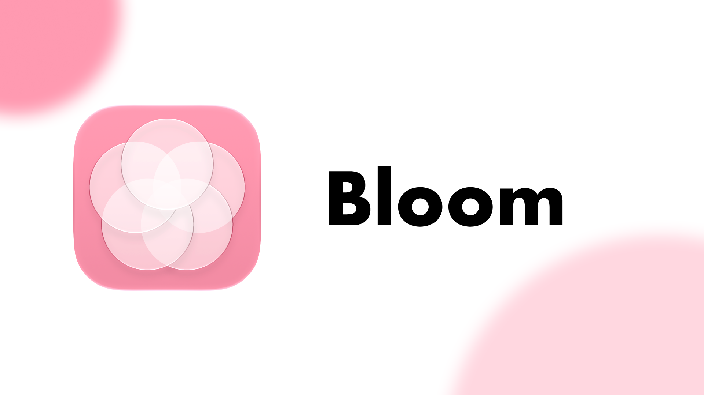

# Bloom

## 製品概要
Bloomは、主に大学生をターゲットに、初対面の人たちや一度会っただけの人とのコミュニケーションを活性化し、その人について深く知り、会話に花を咲かせるためのプロジェクトです。
近くにいる人をUWBで検知し、どのくらい一緒にいたかを基に相手のプロフィールが徐々に開いていきます。

### 背景(製品開発のきっかけ、課題等）
大学生活を過ごしていて、同じテーブルを囲んでいる人たちと会話をする場面は多く出逢いますが、仲間の名前が思い出せなかったり、趣味や共通の話題がうまく引き出せなかったりすることがあると思います。
これは初対面に限らず、何度か授業で出会っているけれどあまり話したことがなかったり、情報を聞き出す場面を逃してしまったりということがあると思います。
私たちはこれを技術で解決するべく、このプロジェクトを考案しました。

### 製品説明（具体的な製品の説明）
UWB（超広帯域無線）を使って、アプリを利用している相手の端末との距離を取得します。
近くで過ごした時間を相手ごとに記録し、その累計に応じて、本人が公開を許可した趣味や会話のきっかけを段階的に表示する体験を目指しています。
将来的には、近くにいる複数の相手を画面上に表示し、ARを通じて相手の位置とプロフィールを結び付けることを考えています。

### 特長
#### 1. 現実の距離が交流のきっかけになる
端末間の距離を取得し、近くにいる相手との関わりをアプリ上の体験につなげます。
#### 2. 過ごした時間に応じて開くプロフィール
最初からすべての情報を表示するのではなく、出会いや時間の積み重ねに応じて、相手のことを少しずつ知れる仕組みを目指します。
こうすることで、出会いが一度で終わらずにより相手のことを知るきっかけが醸成されると考えています。
#### 3. 公開する情報は本人が選べる
時間の条件を満たしても、本人が公開を許可していない情報は開示しません。プロフィールの公開意思と、段階的な開示条件を分けて扱うようにしました。

### 解決出来ること
- 以前会ったことがあるのに、名前が思い出せないという課題
- 初対面の相手と話すときの、話題を見つけにくいという課題
- 何度も近くで過ごしている相手と、交流するきっかけがないという課題
- プロフィールを一度に公開することへの抵抗感

### 今後の展望
今の実装では一般的なスマートフォンアプリにありがちなUIであるため、ARによる没入型体験を提供したいと考えています。
これにより現実世界とこのアプリとの結び付けを強め、アプリ自体の完成度を高めていきたいです。
また、UWBで取得した方向情報を活用し、相手との位置関係を分かりやすく把握できる機能の実現を目指します。
さらにAndroidにも対応し、iPhone利用者に限らず、より多くの人が同じ場でBloomを利用できるようにしていきます。

### 注力したこと（こだわり等）
- 相手ごとに接続状態と計測値を管理し、情報の取り違えを防ぐこと
- 距離や方向が取得できないときに、古い値や不明な値を正確な位置として表示しないこと
- 通信・計測・表示・保存の役割を分け、機能を段階的に拡張できる構成にすること

## 開発技術
### 活用した技術
#### API・データ
- Nearby Interactionによる端末間の距離・方向の取得
- Network.frameworkおよびBonjourによる端末発見
- Supabaseによるプロフィール等データ保存

#### フレームワーク・ライブラリ・モジュール
- Swift / Swift Concurrency
- SwiftUI / Observation
- Network.framework
- Nearby Interaction

#### デバイス
- UWBに対応したiPhone
- iOS 26.0以上
- 実際の測距には、対応する実機が2台以上必要です。複数の相手との同時計測の検証には、3台以上を使用します。

### 独自技術
#### ハッカソンで開発した独自機能・技術
- Network.frameworkとSwift Concurrencyを使った端末間通信
- personIDとNI tokenの交換、および接続先との対応管理
- 接続ごとに距離・方向・欠損・切断状態を扱う複数端末向けAPI
- UWB計測と画面表示を分離した構成
